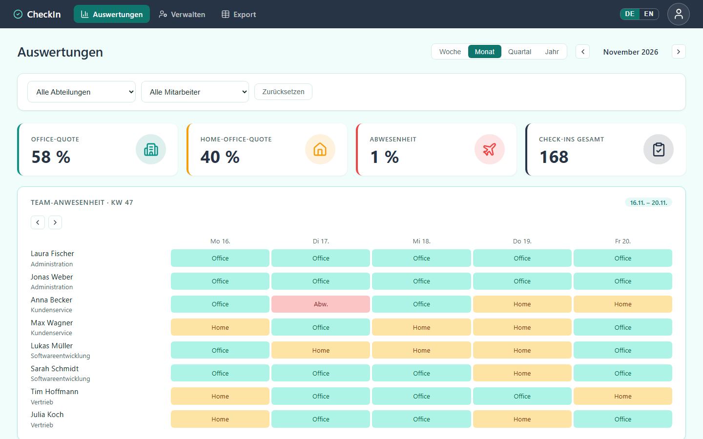
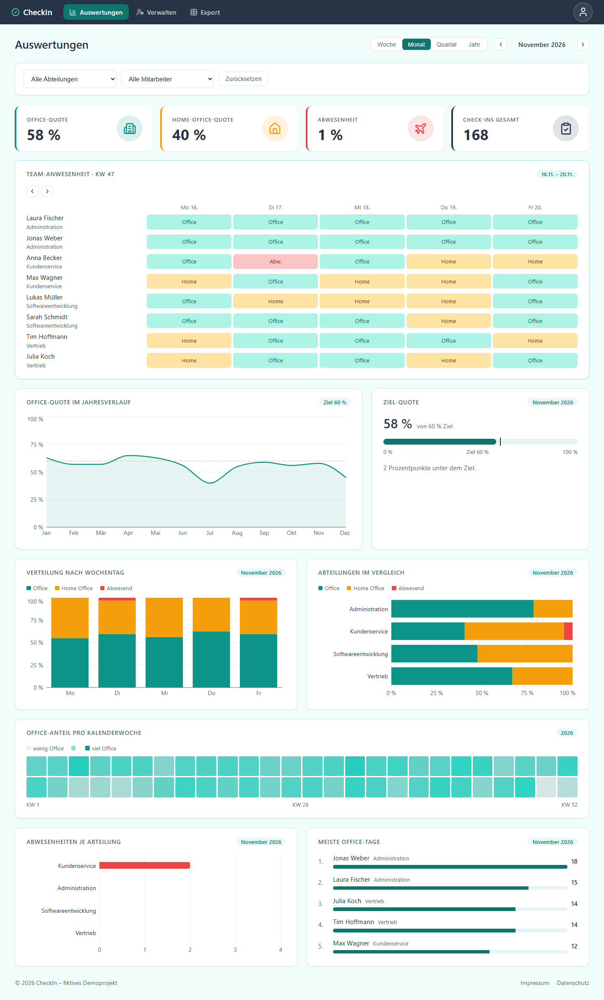
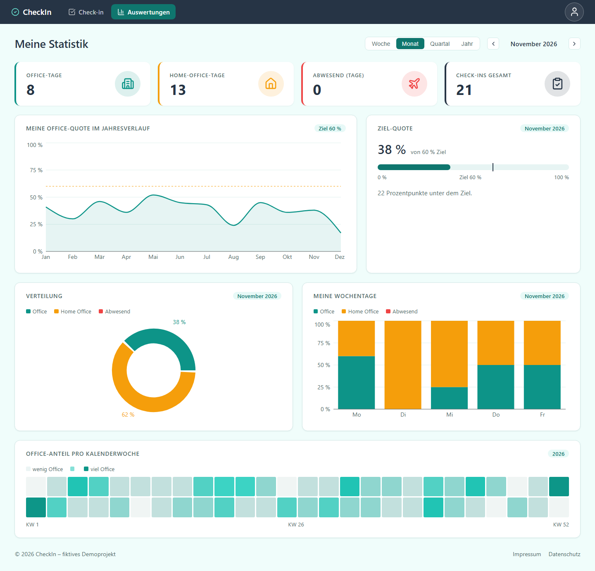
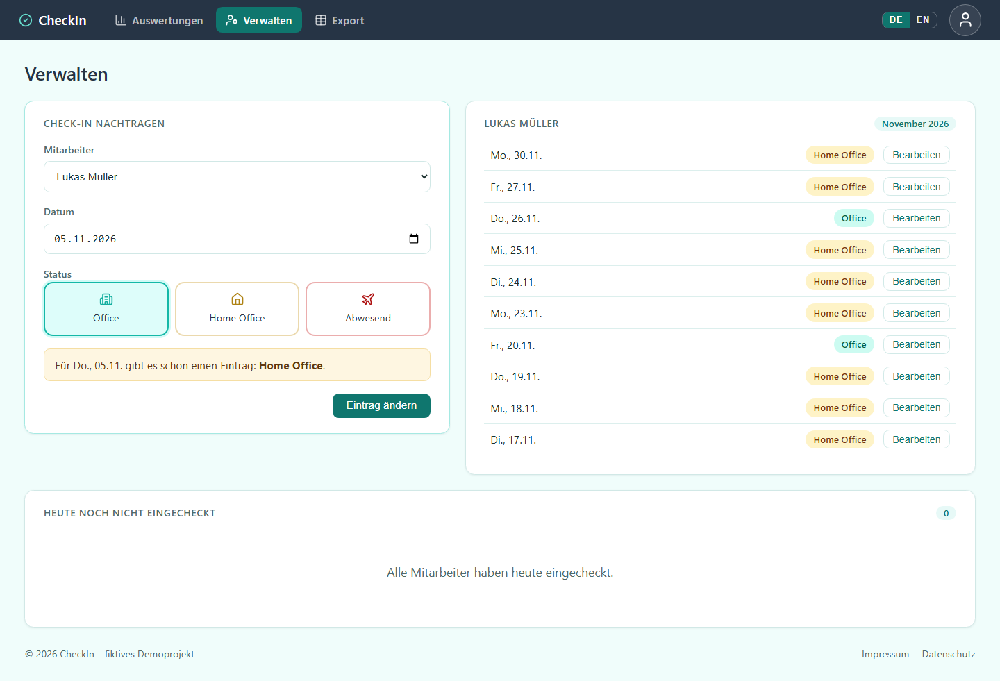
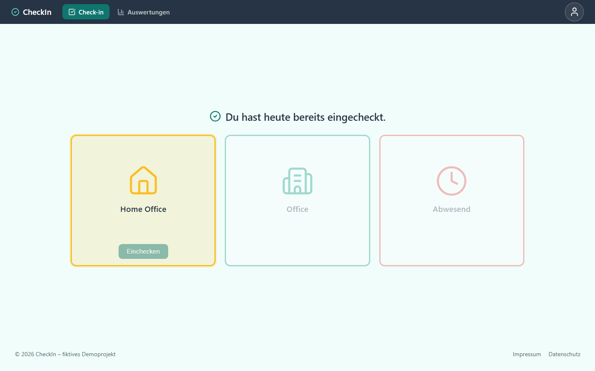
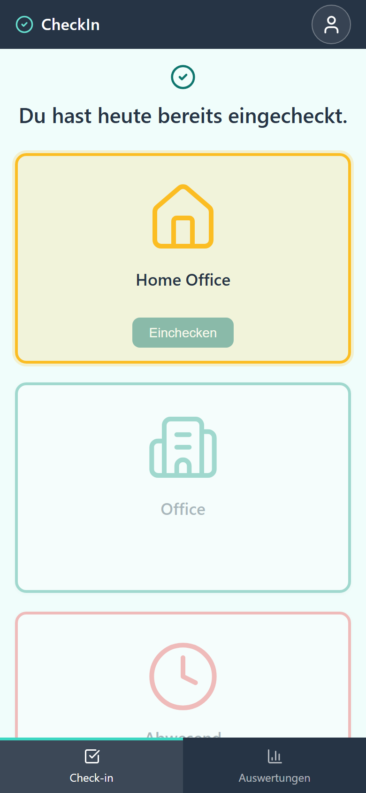
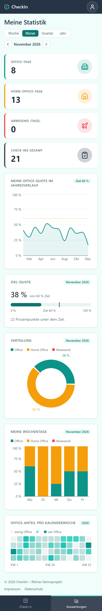

# CheckIn


CheckIn is a web app where employees record their daily work location (Office, Home Office or Absent) and admins analyse attendance by department, employee and period.

> CheckIn is a **fictional demo project**. All employees, departments, company details and check-in data are made-up seed data, and the app is not production-ready as it is (see [Known limitations](#known-limitations)).



<details>
<summary>More screenshots</summary>

<table>
  <tr>
    <td width="50%" valign="top">
      
      <p align="center"><b>Admin: dashboard</b></p>
    </td>
    <td width="50%" valign="top">
      
      <p align="center"><b>Employee: statistics</b></p>
    </td>
  </tr>
  <tr>
    <td width="50%" valign="top">
      
      <p align="center"><b>Admin: add or correct check-ins</b></p>
    </td>
    <td width="50%" valign="top">
      
      <p align="center"><b>Employee: check-in</b></p>
    </td>
  </tr>
</table>

<p>
  
  
</p>

</details>

## Features

- **Daily check-in:** employees pick Office, Home Office or Absent once a day.
- **Admin dashboard:** KPI cards, a Monday-to-Friday team grid, trend against a 60 % office target, weekday and department charts, a year heatmap and rankings. Filter by week, month, quarter or year, by department and by employee. See [Dashboard and charts](docs/dashboard.md).
- **Employee statistics:** the same charts, limited to your own data.
- **Add and correct check-ins:** admins can add a check-in for any past day, correct an existing one and see who has not checked in yet.
- **CSV and PDF export** of filtered attendance records.
- **Role-based access** for `Admin` and `Mitarbeiter` (employee), enforced in the API.
- **Secure sessions:** short-lived JWT access token kept in memory, refresh token rotated on every use and stored in an HttpOnly cookie. See [Architecture](docs/architecture.md#authentication-flow).
- **Responsive UI** from phones to 24" monitors, with a bottom tab bar on small screens.
- **GDPR-oriented pages:** public imprint (`/impressum`) and privacy policy (`/datenschutz`), see [Privacy](docs/privacy.md).

## Prerequisites

- [.NET 10 SDK](https://dotnet.microsoft.com/download)
- [Node.js](https://nodejs.org/) 20.19 or newer (required by Vite 7)
- SQL Server LocalDB (included with Visual Studio) or another SQL Server instance
- The EF Core CLI: `dotnet tool install --global dotnet-ef`

## Quick start

1. Create `backend/appsettings.Development.json` (it is git-ignored). See [Configuration](#configuration) for the keys:

   ```json
   {
     "ConnectionStrings": {
       "DefaultConnection": "Server=(localdb)\\MSSQLLocalDB;Database=CheckInDev;Trusted_Connection=True;TrustServerCertificate=True"
     },
     "Jwt": {
       "Key": "replace-with-a-random-key-of-at-least-32-characters",
       "Issuer": "CheckInAPI",
       "Audience": "CheckInUsers",
       "ExpiresInMinutes": 15
     }
   }
   ```

2. Start the API. It creates the schema with the migrations and, in `Development`, seeds demo data.

   ```bash
   cd backend
   dotnet ef database update
   dotnet run --launch-profile https   # https://localhost:7005, Swagger at /swagger
   ```

3. Start the frontend in a second terminal:

   ```bash
   cd frontend
   npm install
   npm run dev   # usually http://localhost:5173
   ```

4. Open the printed URL and sign in with a demo account:

   | Role | Email | Password |
   |------|-------|----------|
   | Admin | `admin@checkin.de` | `Admin123!` |
   | Employee | `l.mueller@checkin.de` | `Passwort123!` |

   The seed creates eight employees (all with the password `Passwort123!`) and a check-in for every weekday of 2026. Seeding is idempotent: missing days are added and existing entries stay untouched.

The API only accepts requests from the origins in the CORS policy in [`backend/Program.cs`](backend/Program.cs): `localhost` ports 5173, 5174 and 5176. If Vite picks another port, free port 5173 or add the origin there.

## Configuration

| Key | Description | Required |
|-----|-------------|----------|
| `ConnectionStrings:DefaultConnection` | SQL Server connection string | yes |
| `Jwt:Key` | Secret for signing access tokens, at least 32 characters | yes |
| `Jwt:Issuer` | Token issuer, for example `CheckInAPI` | yes |
| `Jwt:Audience` | Token audience, for example `CheckInUsers` | yes |
| `Jwt:ExpiresInMinutes` | Access token lifetime, 15 is a sensible value | yes |

Put them in `backend/appsettings.Development.json`, in environment variables (`Jwt__Key`) or in your deployment's secret store. Never commit real keys or passwords.

## Tests

```bash
dotnet test backend.Tests/backend.Tests.csproj   # backend, from the repository root

cd frontend
npm test                                         # frontend
npm run lint
```

287 automated tests (105 backend, 182 frontend) cover the services, the seed data, the API with authentication and roles, and the React components and pages. Results and screenshots are in [tests.md](tests.md).

## Documentation

- [Architecture](docs/architecture.md): tech stack, project structure, authentication flow, domain terms
- [API reference](docs/api.md)
- [Dashboard and charts](docs/dashboard.md)
- [Privacy (GDPR)](docs/privacy.md)

## Known limitations

- There is no e-mail service: accounts come from the seed data, users cannot be invited by e-mail.
- Demo accounts have fixed, well-known passwords. They are only created in the `Development` environment, so never run a production deployment as `Development`.
- Demo data and all year filters are limited to 2026.
- No CI pipeline and no end-to-end tests in a browser.

## Contributing

Bug reports and pull requests are welcome. See [CONTRIBUTING.md](CONTRIBUTING.md).

## Support

Open an issue on [GitHub Issues](https://github.com/TranceMeli/CheckIn/issues).

## License

[MIT](LICENSE)
