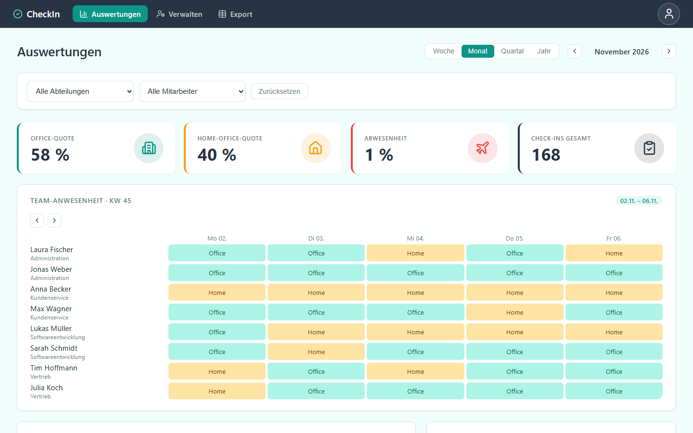
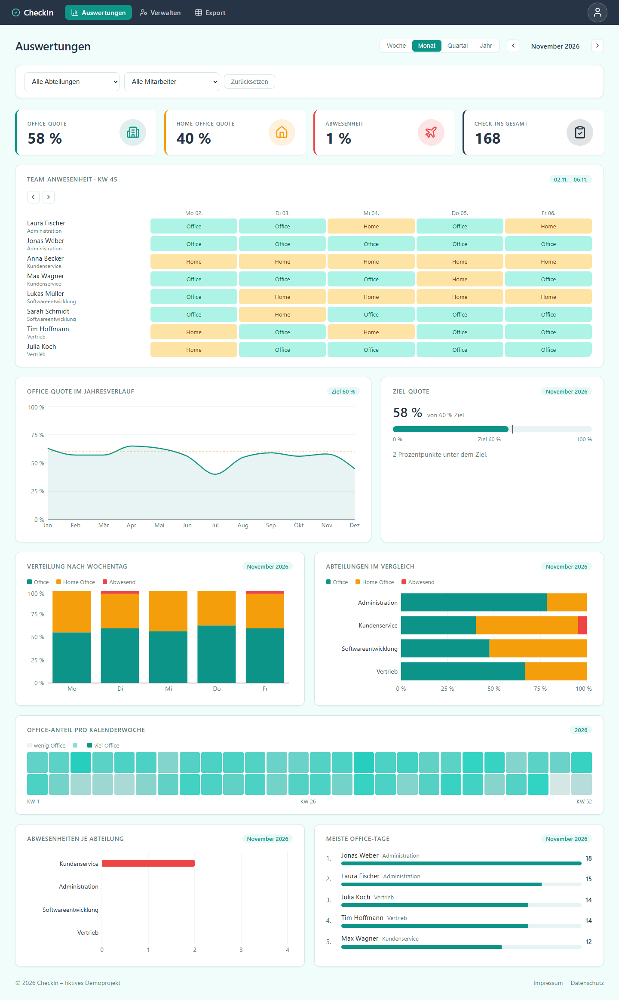
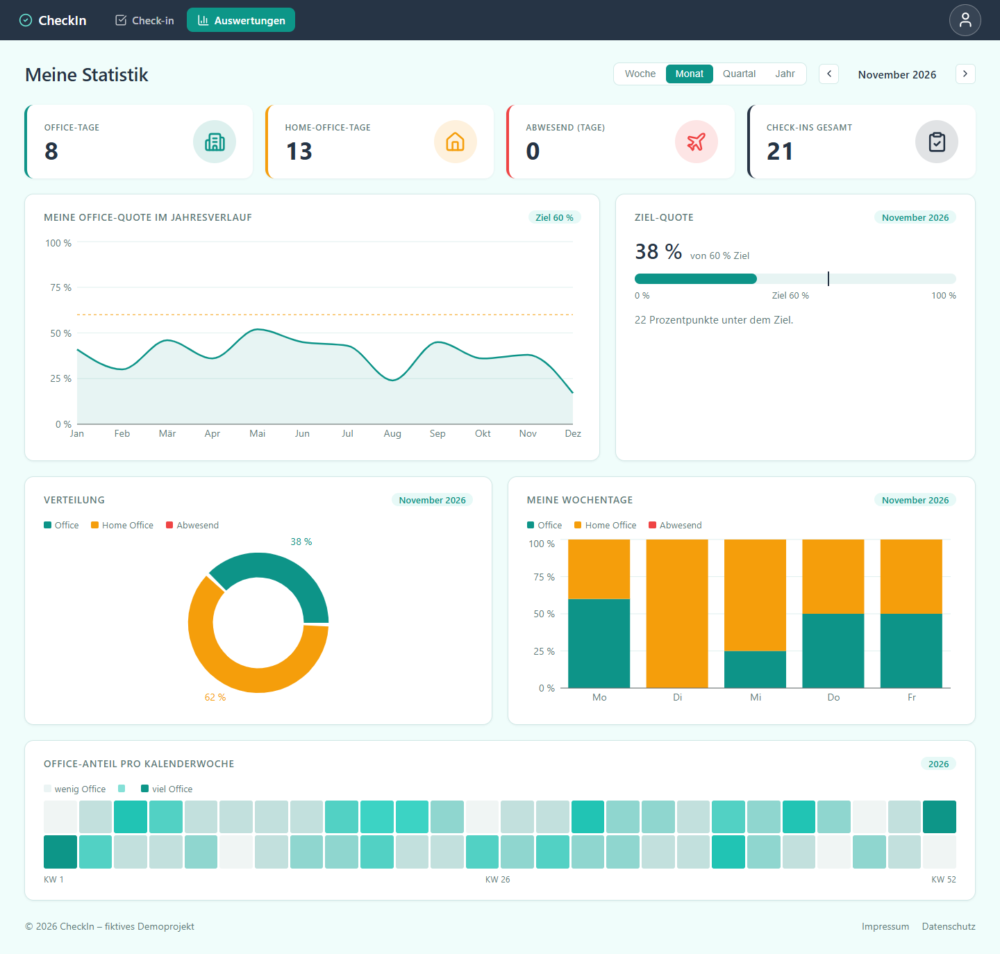
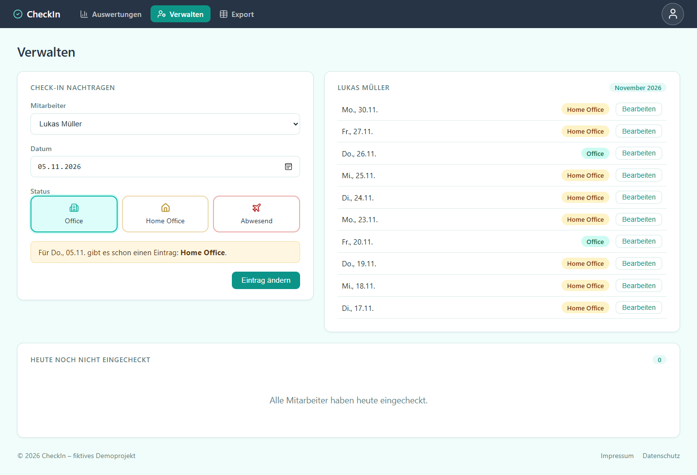
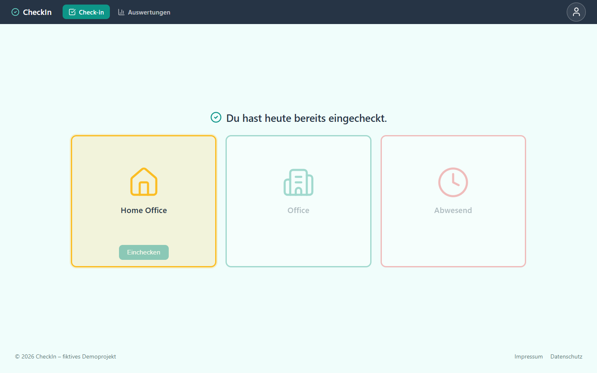
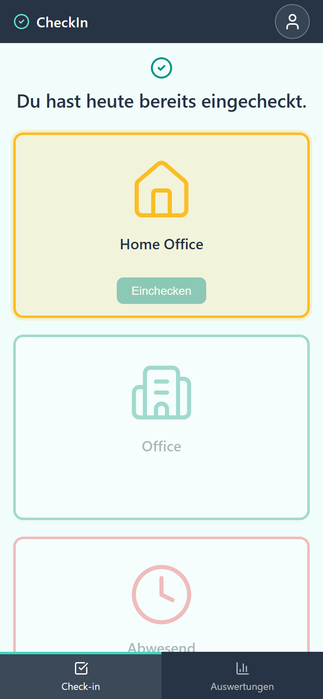
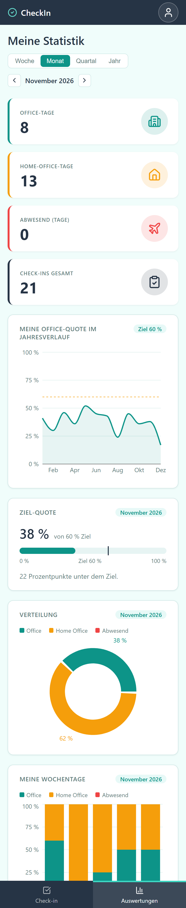
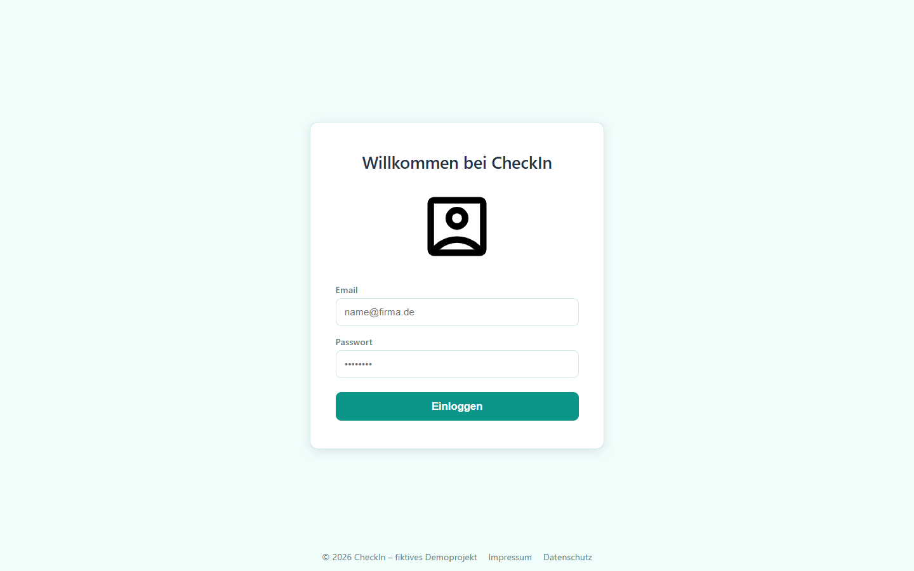

# CheckIn




A full-stack web application for tracking employee attendance with role-based access control, JWT authentication with refresh token rotation, and an analytics dashboard.

> CheckIn is a **fictional demo project**. All employees, departments, company details and check-in data are made-up seed data.

## Highlights

- **Responsive, fluid UI** — all sizes use `rem` with a fluid root font size (`clamp(16px, 0.5vw + 10.5px, 24px)`), so the interface grows on large monitors and shrinks on small ones. On tablets and phones the navigation moves to a bottom tab bar.
- **Layout** — top navigation bar, user menu (avatar icon with e-mail, role and logout) that only appears when someone is signed in.
- **Admin dashboard** with a period switcher (week / month / quarter / year) and six additional charts, see [Dashboard & charts](#dashboard--charts).
- **Employee statistics** with the same chart family, limited to the signed-in user's own data.
- **"Verwalten" page** — add check-ins for any past day, correct existing entries, see an employee's entries for the month and who has not checked in today.
- **Responsive check-in page** — the three status cards sit side by side and stack on small screens.
- **Icons on all KPI cards** (Office, Home Office, Absent, Total).
- **GDPR-oriented pages** — footer, imprint (`/impressum`) and privacy policy (`/datenschutz`), reachable without login. Contents are placeholders for the fictional company.
- **Full-year demo data** for 2026 (weekdays, vacation blocks) and department names. Other years are hidden in all filters.

## Screenshots

<table>
  <tr>
    <td width="50%" valign="top">
      
      <p align="center"><b>Admin: Dashboard</b><br>Period switcher, KPI cards, team week grid, trend, target meter, weekday and department charts, heatmap, absences and ranking</p>
    </td>
    <td width="50%" valign="top">
      
      <p align="center"><b>Employee: Statistics</b><br>The same chart family with personal data only</p>
    </td>
  </tr>
  <tr>
    <td width="50%" valign="top">
      
      <p align="center"><b>Admin: Verwalten</b><br>Add or correct check-ins for any past day and see who has not checked in yet</p>
    </td>
    <td width="50%" valign="top">
      
      <p align="center"><b>Employee: Check-in</b><br>Three status cards side by side, stacked on small screens</p>
    </td>
  </tr>
</table>

### Mobile and login

On tablets and phones the navigation moves to a tab bar at the bottom.

<table>
  <tr>
    <td width="33%" valign="top" align="center">
      
      <br><b>Check-in</b>
    </td>
    <td width="33%" valign="top" align="center">
      
      <br><b>Statistics</b>
    </td>
    <td width="33%" valign="top" align="center">
      
      <br><b>Login</b>
    </td>
  </tr>
</table>

---

## Features

- **Daily check-in** — employees log their work location each day: Office, Home Office, or Absent (`Abwesend`)
- **Role-based access** — separate views and permissions for admins and employees (`Mitarbeiter`)
- **Secure authentication** — JWT access tokens stored in memory + HttpOnly refresh token cookies (no localStorage)
- **Automatic token refresh** — axios interceptor silently renews expired tokens without interrupting the user
- **Admin dashboard** — attendance statistics and charts, filterable by department (`Abteilung`), employee and period
- **Employee dashboard** — personal attendance statistics, trend and heatmap
- **CSV & PDF export** — download filtered attendance records
- **Admin corrections** — admins can retroactively add or change a check-in for any employee

---

## Dashboard & charts

| Chart | Where | Shows |
|-------|-------|-------|
| KPI cards | Admin, Employee | Office / Home Office / Absent and total, with icons |
| Team week grid | Admin | Who is where, Monday to Friday, per employee, with week navigation |
| Office rate over the year | Admin, Employee | Monthly office rate against the 60 % target |
| Target meter | Admin, Employee | Office rate of the selected period vs. target |
| Distribution by weekday | Admin, Employee | Share of Office / Home Office / Absent per weekday |
| Departments compared | Admin | 100 % stacked bars per department |
| Year heatmap | Admin, Employee | Office share per calendar week of the year |
| Absences by department | Admin | Absent days per department, highest highlighted |
| Top office days | Admin | Ranking of employees with the most office days |
| Distribution ring | Employee | Office / Home Office / Absent share of the period |

The 60 % target is a constant in `frontend/src/components/chartConfig.js`.

---

## German Domain Terms

Since this app was built for a German-speaking workplace, some domain terms appear in the codebase and UI:

| German | English |
|--------|---------|
| Mitarbeiter | Employee |
| Abteilung | Department |
| Abwesend | Absent |
| Einloggen | Log in |
| Abmelden | Log out |
| Auswertungen | Analytics / Reports |
| Einchecken | Check in |
| Nachtragen | Add retroactively |
| Verwalten | Manage |
| Nachname / Vorname | Last name / First name |
| Datum | Date |
| Impressum / Datenschutz | Imprint / Privacy policy |

### Demo departments

| Department |
|------------|
| Softwareentwicklung |
| Administration |
| Kundenservice |
| Vertrieb |

---

## Tech Stack

### Backend
- ASP.NET Core 8 Web API
- Entity Framework Core with MSSQL (LocalDB for development)
- ASP.NET Core Identity for user management
- JWT Bearer authentication with refresh token rotation
- Roles: `Admin`, `Mitarbeiter` (Employee)

### Frontend
- React 19 with Vite
- React Router
- Axios with request/response interceptors
- Recharts for data visualization
- lucide-react for icons
- react-hot-toast for notifications
- jsPDF + jspdf-autotable for PDF export

---

## Project Structure

```
CheckIn/
├── backend/
│   ├── Controllers/
│   │   ├── AdminController.cs
│   │   ├── AuthController.cs
│   │   ├── CheckInController.cs
│   │   ├── DashboardController.cs
│   │   └── UserController.cs
│   ├── Data/
│   │   ├── AppDbContext.cs
│   │   └── SeedData.cs
│   ├── Dto/
│   │   ├── AdminCheckInDto.cs
│   │   ├── AuthResponseDto.cs
│   │   ├── CheckInDto.cs
│   │   ├── CheckInExportDto.cs
│   │   ├── CheckInListDto.cs
│   │   ├── CheckInStatsDto.cs
│   │   ├── CheckInStatusDto.cs
│   │   ├── CreateUserDto.cs
│   │   ├── DashboardDto.cs
│   │   ├── InviteUserDto.cs
│   │   ├── KursStatsDto.cs
│   │   ├── LoginDto.cs
│   │   ├── SetPasswordDto.cs
│   │   └── UserDto.cs
│   ├── Models/
│   │   ├── AttendanceStatus.cs
│   │   ├── CheckIn.cs
│   │   ├── JwtSettings.cs
│   │   ├── RefreshToken.cs
│   │   └── User.cs
│   ├── Services/
│   │   ├── AuthService.cs
│   │   ├── CheckInService.cs
│   │   ├── DashboardService.cs
│   │   ├── EmailService.cs
│   │   ├── IAuthService.cs
│   │   ├── ICheckInService.cs
│   │   ├── IDashboardService.cs
│   │   ├── IEmailService.cs
│   │   ├── IInvitationService.cs
│   │   ├── IUserService.cs
│   │   ├── InvitationService.cs
│   │   └── UserService.cs
│   └── Program.cs
└── frontend/
    ├── src/
    │   ├── api/
    │   │   └── api.jsx
    │   ├── assets/
    │   ├── components/
    │   │   ├── Button.jsx
    │   │   ├── DashboardCharts.jsx
    │   │   ├── DateTime.jsx
    │   │   ├── ExportTable.jsx
    │   │   ├── Footer.jsx
    │   │   ├── Karte.jsx
    │   │   ├── LegalPage.jsx
    │   │   ├── Navbar.jsx
    │   │   ├── PeriodBar.jsx
    │   │   ├── StatCard.jsx
    │   │   ├── Toast.jsx
    │   │   ├── UserMenu.jsx
    │   │   └── chartConfig.js
    │   ├── contexts/
    │   │   └── AuthContext.jsx
    │   ├── layout/
    │   │   └── MainLayout.jsx
    │   ├── pages/
    │   │   ├── AdminList.jsx
    │   │   ├── AdminManage.jsx
    │   │   ├── AdminPanel.jsx
    │   │   ├── CheckInPage.jsx
    │   │   ├── Dashboard.jsx
    │   │   ├── Datenschutz.jsx
    │   │   ├── Impressum.jsx
    │   │   ├── Login.jsx
    │   │   ├── Unauthorized.jsx
    │   │   └── UserView.jsx
    │   ├── routes/
    │   │   └── ProtectedRoute.jsx
    │   ├── styles/
    │   │   ├── App.css
    │   │   ├── components.css
    │   │   ├── dashboard.css
    │   │   ├── index.css
    │   │   ├── legal.css
    │   │   ├── manage.css
    │   │   └── pages.css
    │   ├── utils/
    │   │   └── zeitraum.js
    │   └── main.jsx
    └── vite.config.js
```

---

## Getting Started

### Prerequisites

- [.NET 8 SDK](https://dotnet.microsoft.com/download)
- [Node.js 18+](https://nodejs.org/)
- SQL Server LocalDB (included with Visual Studio) or a full SQL Server instance

### Backend

Create `backend/appsettings.Development.json` first — it is git-ignored and holds your local connection string and secrets, see [Configuration](#configuration).

```bash
cd backend

# Restore packages
dotnet restore

# Apply migrations and create the database
dotnet ef database update

# Start the API — runs on https://localhost:7005
dotnet run --launch-profile https
```

The first run automatically seeds the database with an admin account, sample employees and check-ins for every weekday of 2026. Seeding is idempotent: missing days are added, existing entries stay untouched, and employees from older versions are moved to the current department names.

> Only the .NET 10 runtime installed? Run with `DOTNET_ROLL_FORWARD=Major` so the .NET 8 project can start.

**Default credentials (fictional demo accounts):**

| Role | Email | Password |
|------|-------|----------|
| Admin | admin@checkin.de | Admin123! |
| Mitarbeiter (Employee) | l.mueller@checkin.de | Passwort123! |

All eight demo employees use the password `Passwort123!`. Change or remove these accounts before any real deployment.

### Frontend

```bash
cd frontend

# Install dependencies
npm install

# Start the dev server — usually http://localhost:5173
npm run dev
```

The backend only accepts requests from the origins listed in the CORS policy in `backend/Program.cs` (`localhost` ports 5173, 5174 and 5176). If Vite picks another port because 5173 is busy, add that origin there or free the port.

---

## Authentication Flow

```
Login
  └─► Access Token (in-memory)  +  Refresh Token (HttpOnly Cookie)
              │
              ▼
       API request with Bearer token
              │
         401 Unauthorized?
              │
              ▼
       POST /api/Auth/refresh  ← cookie sent automatically by browser
              │
              ▼
       New Access Token → original request retried
              │
         Refresh failed?
              │
              ▼
       Forced logout → redirect to /login
```

- **Access tokens** expire after 15 minutes and are never written to `localStorage` or `sessionStorage`
- **Refresh tokens** are valid for 7 days, rotated on every use, and stored as `HttpOnly; Secure; SameSite=None` cookies — inaccessible to JavaScript
- The refresh call made at app start (to restore a session) never triggers a forced logout, so the public pages `/impressum` and `/datenschutz` stay reachable without login

---

## API Endpoints

### Auth

| Method | Endpoint | Auth | Description |
|--------|----------|------|-------------|
| POST | `/api/Auth/login` | Public | Login, returns access token + sets refresh cookie |
| POST | `/api/Auth/refresh` | Public | Issue new access token using HttpOnly cookie |
| POST | `/api/Auth/logout` | Public | Revoke refresh token and clear cookie |

### CheckIn (Mitarbeiter / Employee)

| Method | Endpoint | Description |
|--------|----------|-------------|
| POST | `/api/CheckIn/set-status` | Submit today's attendance status |
| GET | `/api/CheckIn/checkin` | Get today's / the latest check-in status (future demo entries are ignored) |
| GET | `/api/CheckIn/stats/me` | Get personal attendance statistics |
| GET | `/api/CheckIn/dashboard/overview` | Own totals and weekday distribution for `von`/`bis` |
| GET | `/api/CheckIn/dashboard/verlauf` | Own monthly counts for a `jahr` |
| GET | `/api/CheckIn/dashboard/heatmap` | Own office share per calendar week for a `jahr` |

The employee dashboard endpoints only ever return the signed-in user's own data; department comparison and ranking are admin-only.

### Dashboard (Admin only)

| Method | Endpoint | Description |
|--------|----------|-------------|
| GET | `/api/Dashboard/overview` | Totals, weekday distribution, department comparison and top-5 ranking for `von`/`bis`, filterable by `abteilung` and `userId` |
| GET | `/api/Dashboard/verlauf` | Monthly counts for a `jahr` |
| GET | `/api/Dashboard/heatmap` | Office share per calendar week for a `jahr` |
| GET | `/api/Dashboard/team-woche` | Monday to Friday status per employee for the week starting at `montag` |

### User (Admin only)

| Method | Endpoint | Description |
|--------|----------|-------------|
| GET | `/api/User` | List all users (including admins) |
| GET | `/api/User/mitarbeiter` | List employees only (used by all selection lists) |
| GET | `/api/User/{id}` | Get user by ID |
| GET | `/api/User/{userId}/checkins` | An employee's check-ins between `von` and `bis` |
| GET | `/api/User/stats` | Attendance statistics with filters |
| GET | `/api/User/stats/abteilungen` | Statistics grouped by department |
| POST | `/api/User/{userId}/checkin` | Add a check-in for a past day (`status`, optional `datum`); `409` if one already exists |
| PUT | `/api/User/{userId}/checkin` | Correct (overwrite) an existing check-in; `400` for future dates |
| GET | `/api/User/export` | Export attendance data (CSV/PDF rendered in frontend) |

---

## Configuration

`backend/appsettings.Development.json` (git-ignored) or `backend/appsettings.json`:

```json
{
  "ConnectionStrings": {
    "DefaultConnection": "Server=(localdb)\\MSSQLLocalDB;Database=CheckInDev;Trusted_Connection=True;TrustServerCertificate=True"
  },
  "Jwt": {
    "Key": "your-secret-key-minimum-32-characters",
    "Issuer": "CheckInAPI",
    "Audience": "CheckInUsers",
    "ExpiresInMinutes": 15
  }
}
```

Never commit real keys or passwords.

---

## Privacy (GDPR)

The app contains a footer with links to an imprint and a privacy policy. Both pages are public and use placeholder data for the fictional company "Muster Software GmbH".

- Only one technically necessary cookie is used (`refreshToken`), so no cookie banner is needed
- No tracking, analytics or third-party scripts and fonts
- Employees see only their own data; admins see everyone's
- The retention periods named in the policy (e.g. 24 months for check-ins) are examples — the application does **not** delete data automatically

For real use, replace the placeholder texts and have them reviewed legally.

---

## Known limitations

- There is no e-mail service: users cannot be invited by e-mail, accounts come from the seed data.
- No automated tests and no CI.
- Seed data creates accounts with fixed, well-known passwords on every start; restrict seeding to development before deploying.
- The demo data and all year filters are limited to 2026.

---

## License

This project is licensed under the MIT License.
