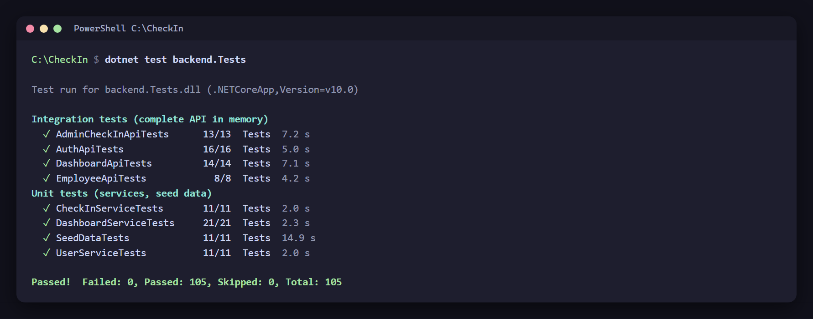
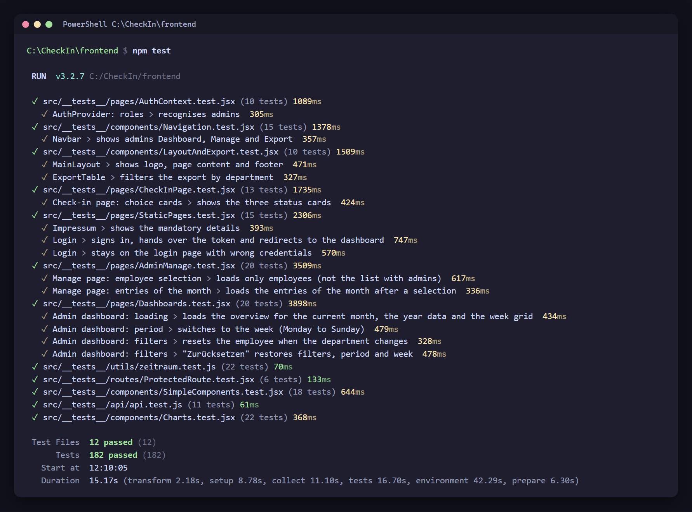
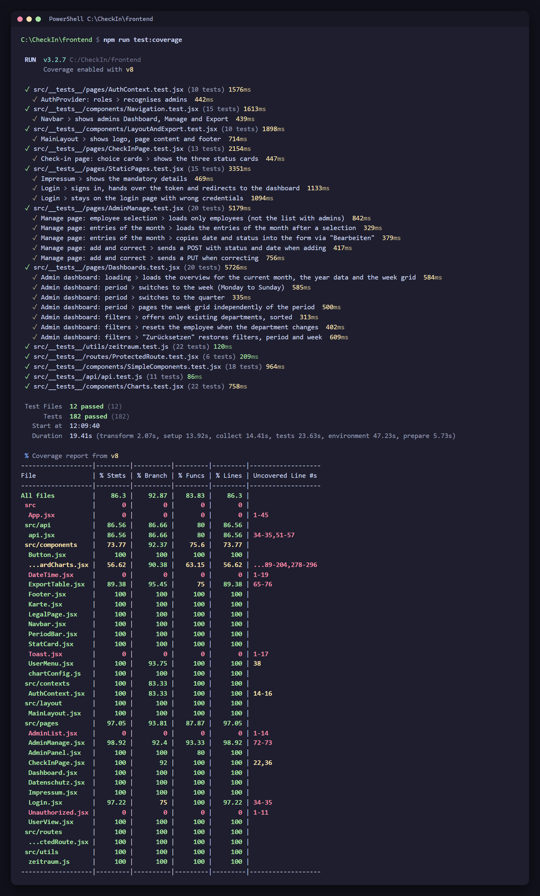
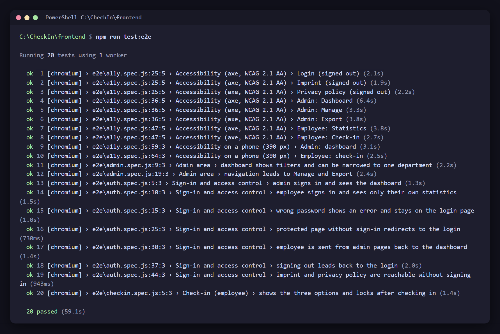

# Testing

How to run, write and debug the tests of CheckIn. Which tests exist and how the last run went is listed in [tests.md](../tests.md) (in German).

## Prerequisites

| For | You need |
|-----|----------|
| Backend tests | [.NET 10 SDK](https://dotnet.microsoft.com/download) |
| Frontend tests | [Node.js](https://nodejs.org/) 20.19 or newer, then `npm install` in `frontend` |
| End-to-end and accessibility tests | additionally SQL Server LocalDB, the file `backend/appsettings.Development.json` (see the [README](../README.md#quick-start)), applied migrations (`dotnet ef database update`) and, once, `npx playwright install chromium` |

The end-to-end tests need the ports **7005** (API) and **5176** (frontend) to be free. If something else is listening there, the start fails with an error instead of testing a foreign app.

Backend and frontend tests need neither a database nor running servers.

## Running tests

```bash
# Backend, from the repository root
dotnet test backend.Tests/backend.Tests.csproj

# Frontend, in the frontend folder
npm test                  # all unit tests once
npm run test:watch        # re-run on every change
npm run test:coverage     # with coverage report (frontend/coverage)
npm run lint              # static analysis
npm run test:e2e          # browser tests, starts the API and the frontend itself
```

Run a subset:

```bash
dotnet test backend.Tests/backend.Tests.csproj --filter "FullyQualifiedName~DashboardServiceTests"
npx vitest run src/__tests__/pages/CheckInPage.test.jsx
npx vitest run -t "shows the three status cards"
npx playwright test auth                 # only auth.spec.js
npx playwright test -g "signing out"     # by test name
```

Before a pull request, run at least the tests of the part you changed. If you changed the UI, run `npm run test:e2e` as well.

### What a run looks like

**Backend** (105 tests)



**Frontend** (182 tests)



**Frontend coverage** (86 % of statements, 93 % of branches)



**End-to-end and accessibility** (20 tests)



The images are rendered from the real console output of the runs. Test names are English. The few German words in quotes are UI texts the tests check, because the app itself is German.

## Test types

| Type | Tool | Location | What it checks | Duration |
|------|------|----------|----------------|----------|
| Backend, unit | xUnit, EF Core InMemory | `backend.Tests/Unit` | services and seed data with a real `UserManager` | seconds |
| Backend, integration | xUnit, `WebApplicationFactory` | `backend.Tests/Integration` | the complete API with authentication, roles and status codes | seconds |
| Frontend | Vitest, React Testing Library, jsdom | `frontend/src/__tests__` | components, pages, routes, helpers, the API client | about 20 s |
| End-to-end | Playwright (Chromium) | `frontend/e2e` | login, access control, check-in and admin area in a real browser | about 1 minute |
| Accessibility | axe-core via Playwright | `frontend/e2e/a11y.spec.js` | WCAG 2.1 A and AA on all pages, also at 390 px width | part of the e2e run |

The mix follows the test pyramid: many fast unit tests, fewer integration tests and a few e2e tests for the most important flows.

Not covered: load tests, cross-browser tests (Chromium only) and keyboard or screen reader use. axe finds only part of the accessibility problems, the rest needs a manual check.

## Writing tests

Rules for every level: a test checks **one behaviour**, does not depend on the results of other tests and has a **concrete assertion** (an expected value, not just "no error"). Test the failure cases too: wrong role, missing login, invalid input, empty data and boundary values.

**When you fix a bug, write the test that reproduces it first**, then fix the bug. The list in [tests.md](../tests.md#regressionstests) shows which bugs are covered this way.

### Backend, unit test

A service test creates data with `TestDb` and calls the service directly:

```csharp
public class CheckInServiceTests : IDisposable
{
    private readonly TestDb _db = new();
    public void Dispose() => _db.Dispose();

    [Fact]
    public async Task CheckIn_twice_on_the_same_day_keeps_the_first_status()
    {
        var user = await _db.AddUserAsync("a@test.de", "Anna", "Becker", "Vertrieb");
        // call the service, then assert against _db.Context
    }
}
```

### Backend, integration test

An API test uses `ApiFactory` through `IClassFixture` and calls the endpoints over HTTP:

```csharp
public class MyApiTests : IClassFixture<ApiFactory>
{
    private readonly ApiFactory _factory;
    public MyApiTests(ApiFactory factory) => _factory = factory;

    [Fact]
    public async Task Employee_gets_403_on_an_admin_route()
    {
        var email = $"{Guid.NewGuid():N}@test.de";
        await _factory.CreateUserAsync(email);                 // role "Mitarbeiter"
        var client = await _factory.LoginClientAsync(email);   // signs in and sets the bearer token

        var response = await client.GetAsync("/api/Dashboard/overview");

        Assert.Equal(HttpStatusCode.Forbidden, response.StatusCode);
    }
}
```

### Frontend

Pages and components are rendered with React Testing Library. Query by role or text (`getByRole`, `findByText`) rather than by CSS class where possible. The API client and `react-hot-toast` are replaced:

```jsx
const { api } = vi.hoisted(() => ({ api: { get: vi.fn(), post: vi.fn() } }))
vi.mock('../../api/api', () => ({ api }))

it('shows the three status cards', async () => {
  api.get.mockRejectedValue({ response: { status: 404 } })   // not checked in yet
  render(<CheckInPage />)
  expect(await screen.findByText('Home Office')).toBeInTheDocument()
})
```

Use `userEvent` for interactions and `findBy…` or `waitFor` for asynchronous output, never fixed waits.

### End-to-end

E2E tests live in `frontend/e2e/*.spec.js` and use the helpers from `helpers.js` (`login`, `hauptnavigation` and the demo accounts `ADMIN` and `MITARBEITER`):

```js
test('signing out leads back to the login', async ({ page }) => {
  await login(page, ADMIN)
  await page.getByRole('button', { name: 'Benutzermenü' }).click()
  await page.getByRole('menuitem', { name: /abmelden/i }).click()
  await expect(page).toHaveURL(/\/login$/)
})
```

Find elements by role and visible name (`getByRole`, `getByLabel`). Playwright waits until an element is ready on its own. Write e2e tests only for what really needs a browser, everything else belongs to the levels below.

A new page gets an entry in `a11y.spec.js`.

## Test data and mocks

| Level | Data | Isolation |
|-------|------|-----------|
| Backend, unit | `TestDb` creates its own InMemory database per instance (a `Guid` as name). `AddUserAsync` and `AddCheckInAsync` create test data | each test class has its own database, `Dispose` cleans up |
| Backend, integration | `ApiFactory` starts the API with its own InMemory database per class. In the `Testing` environment **nothing is seeded**. The JWT key is a test value | tests in a class share the database, so each test creates its own users (`Guid` e-mail) |
| Frontend | The API client and the toasts are replaced with `vi.mock`, there is no network access. `src/test/setup.js` cleans up after each test (`cleanup`, `vi.restoreAllMocks`) and adds `matchMedia`, which jsdom does not provide | mocks are reset in `beforeEach` |
| E2E | The real app with the real LocalDB and the seed data (`Development` environment): every weekday of 2026, eight employees, the admin | tests share the database, so they run one after another (`workers: 1`) |

One quirk of the e2e tests: the seed data fills every weekday of 2026, so on a weekday the employee has already checked in. The check-in test then checks the locked state and only really checks in on days without an entry (weekend, another year). If you change test data in LocalDB, the seed restores it (it adds missing days but leaves existing entries alone).

Since EF Core 9, `AddDbContext` also registers the SQL Server configuration as an `IDbContextOptionsConfiguration`. `ApiFactory` removes it, otherwise two database providers are active. Keep that when you change the factory.

## CI

The pipeline is in [`.github/workflows/ci.yml`](../.github/workflows/ci.yml). It runs on every push to `main`, on every pull request and every Monday at 05:00 UTC.

| Job | Steps | Blocks the pull request |
|-----|-------|-------------------------|
| Backend | `dotnet test` (Release, .NET 10) | yes |
| Frontend | `npm ci`, `npm run lint`, `npm test`, `npm run build` (Node 22) | yes |
| Dependency scan | `dotnet list package --vulnerable`, `npm audit --audit-level=high` | no (`continue-on-error`) |

The scan does not block because part of the npm findings sit in test and build tools (Vitest, Vite) and can only be fixed with a major update.

**Not in CI:** the e2e and accessibility tests. They need SQL Server and the configuration file with the JWT key. Run them locally with `npm run test:e2e`. CI would need a SQL Server container and a test configuration.

A red run: open the failed step in the *Actions* tab, the error is in the log. If you can reproduce it locally with the commands above, it is not a CI problem.

## Debugging

**Backend**

```bash
dotnet test backend.Tests/backend.Tests.csproj --filter "FullyQualifiedName~AuthApiTests" --logger "console;verbosity=detailed"
```

For integration tests, print the status code and the body first (`await response.Content.ReadAsStringAsync()`). If the factory reports "two providers", the removal of the `IDbContextOptionsConfiguration` in `ApiFactory` has been lost.

**Frontend (Vitest)**

- `npm run test:watch` runs only the affected tests and restarts on every change.
- `screen.debug()` prints the rendered HTML, `logRoles(container)` (from `@testing-library/react`) lists the roles and names that `getByRole` can find.
- "Unable to find …" often means the output appears asynchronously: use `findBy…` instead of `getBy…`.

**E2E (Playwright)**

```bash
npx playwright test --headed                 # visible browser
npx playwright test --ui                     # interactive UI with a timeline
npx playwright test --debug                  # step by step
npx playwright show-trace test-results/<folder>/trace.zip
```

On a failure, Playwright writes a trace and a page snapshot (`error-context.md`) to `frontend/test-results/`. The trace shows every step with a screenshot, the network calls and the console.

Common causes:

| Symptom | Cause |
|---------|-------|
| All tests run into timeouts | The API does not start: LocalDB, `appsettings.Development.json` or the migrations are missing. `dotnet run --project backend --launch-profile https` shows the error |
| "Port 5176 is already in use" | Another app uses the port. Stop it, or stop the running CheckIn instance |
| Login fails | The seed data is missing (created only in `Development`) or the passwords were changed |
| Request blocked by CORS | The backend only allows the ports 5173, 5174 and 5176 (`backend/Program.cs`) |

**axe errors** name the rule, the elements (selector) and, for contrast errors, the measured colours and the required ratio. Example: `color-contrast … foreground color: #0d9488 … expected 4.5:1`. Change the colour, not the test.

## Conventions

- **Location:** backend unit tests in `backend.Tests/Unit/<Class>Tests.cs`, API tests in `backend.Tests/Integration/<Area>ApiTests.cs`, frontend tests in `frontend/src/__tests__/` with the same structure as `src` (`pages`, `components`, `routes`, `api`, `utils`), e2e tests in `frontend/e2e/<topic>.spec.js`.
- **Names:** all test names are English. Backend tests are sentences with underscores that state the result (`Admin_can_add_a_check_in_for_a_past_day`), frontend and e2e tests are plain sentences (`it('shows the three status cards')`). Texts of the German UI that a test looks for (button names, headings) stay German and go in quotes, for example `signs out via "Abmelden"`.
- **Structure:** arrange, act, assert, in that order and without logic in the test (no loops or conditions that hide the result). The date-dependent check-in e2e test is an exception and explains why in a comment.
- **Independent:** no test relies on another. Each creates its own data and does not clean up other people's data.
- **Stable:** no fixed waits (`sleep`, `waitForTimeout`) and no dependence on the time of day unless it is part of the test. Flaky tests get fixed, not skipped.
- **Behaviour, not implementation:** assert what users or callers see, not internal variables or private methods.
- **Comments:** only the *why* (a rule, an edge case, a workaround), not the *what*.
- **Before merging:** `dotnet test`, `npm test`, `npm run lint` and, for UI changes, `npm run test:e2e` pass. New colours need a contrast of at least 4.5:1 (the axe test checks it).
- **Documentation:** when the number or kind of tests changes, update `tests.md`.
