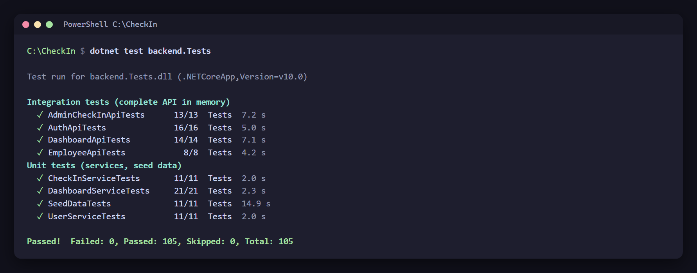
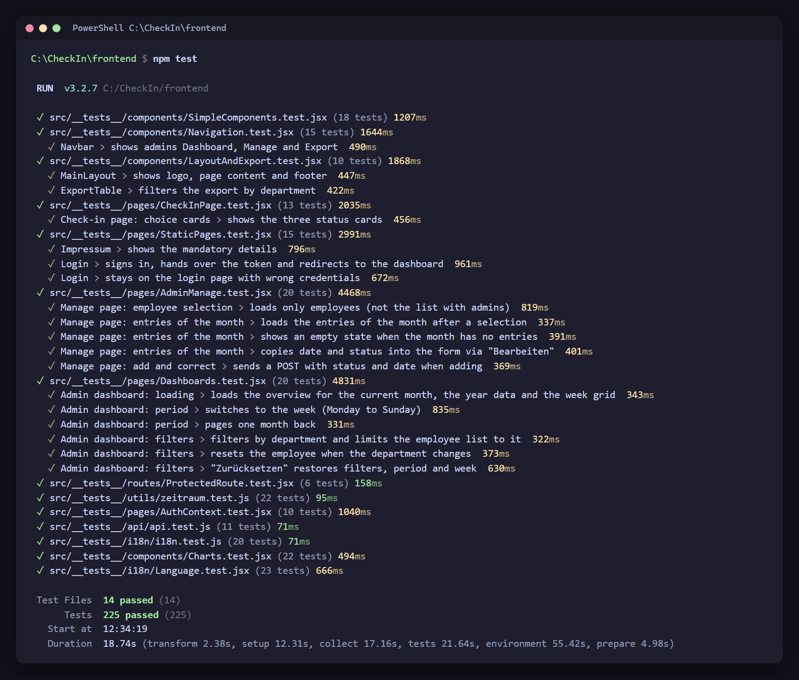
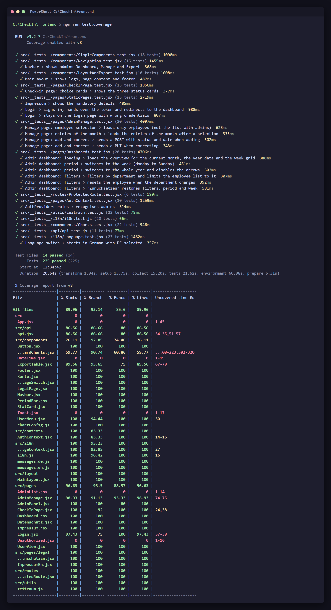
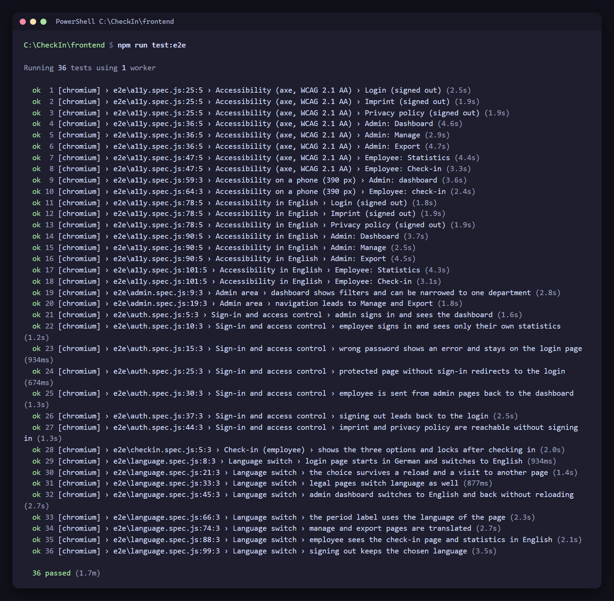

# Tests

Wie man Tests ausführt, schreibt und Fehler findet, steht in [docs/testing.md](docs/testing.md).

CheckIn hat automatisierte Tests für Backend, Frontend und den Browser: **105 Backend-Tests**, **225 Frontend-Tests** und **36 End-to-End-Tests** (zusammen 366), alle grün.

Zuletzt ausgeführt auf dem Branch `chore/ci-and-e2e` mit .NET 10 (ASP.NET Core und EF Core 10.0.15, SQL Server LocalDB für die Migrationsprüfung).

| Bereich | Werkzeug | Tests | Ort |
|---------|----------|-------|-----|
| Backend, Unit | xUnit, EF Core InMemory, echter `UserManager` | 54 | `backend.Tests/Unit` |
| Backend, Integration | xUnit, `WebApplicationFactory` (komplette API im Speicher) | 51 | `backend.Tests/Integration` |
| Frontend | Vitest, React Testing Library, jsdom | 225 | `frontend/src/__tests__` |
| End-to-End | Playwright (Chromium) gegen die echte App | 18 | `frontend/e2e` (außer `a11y.spec.js`) |
| Barrierefreiheit | axe-core über Playwright, WCAG 2.1 A und AA | 18 | `frontend/e2e/a11y.spec.js` |

## Ausführen

```bash
# Backend (aus dem Repo-Root)
dotnet test backend.Tests/backend.Tests.csproj

# Frontend
cd frontend
npm test                # einmal ausführen
npm run test:watch      # bei jeder Änderung neu
npm run test:coverage   # mit Abdeckungsbericht (frontend/coverage)

# End-to-End und Barrierefreiheit (einmalig: npx playwright install chromium)
npm run test:e2e
```

Die E2E-Tests starten API und Frontend selbst (`dotnet run` und Vite auf Port 5176) und brauchen daher LocalDB, die Datei `backend/appsettings.Development.json` und die Seed-Daten. Die Ports 7005 (API) und 5176 müssen frei sein. Die Demo-Konten kommen aus den Seed-Daten.

Bei jedem Push und Pull Request führt GitHub Actions (`.github/workflows/ci.yml`) die Backend-Tests, Lint, Frontend-Tests und den Build aus. Die E2E-Tests laufen dort noch nicht, sie brauchen einen SQL Server. Ein wöchentlicher Scan prüft NuGet- und npm-Pakete auf bekannte Schwachstellen.

Backend und Testprojekt laufen auf .NET 10 (`net10.0`). Das Testprojekt braucht dafür das SDK 10.

Zusätzlich zu den Tests habe ich nach dem Upgrade geprüft, dass `dotnet ef migrations has-pending-model-changes` keine Modelländerung meldet, die vier Migrationen angewendet sind, der Login gegen die echte LocalDB funktioniert und Swagger (`/swagger/v1/swagger.json`) 23 Pfade samt Bearer-Schema liefert.

## Screenshots

**Backend**



**Frontend**



**Frontend, Abdeckung** (90 % der Anweisungen, 93 % der Verzweigungen)



**End-to-End und Barrierefreiheit** (36 Tests)



Die Bilder sind aus der echten Konsolenausgabe der Läufe erzeugt (Backend: Ergebnis je Testklasse aus der TRX-Datei).

## Backend

Die Integrationstests starten die echte API mit Authentifizierung und Rollen, aber mit In-Memory-Datenbank. Im Environment `Testing` wird nichts geseedet. Seit EF Core 9 hinterlegt `AddDbContext` die `UseSqlServer`-Konfiguration zusätzlich als `IDbContextOptionsConfiguration<AppDbContext>`. Die Test-Fabrik entfernt sie, sonst sind zwei Datenbank-Provider gleichzeitig aktiv. Dafür legt `Program.cs` Demo-Konten und Demodaten jetzt nur noch in `Development` an.

| Testklasse | Tests | Prüft |
|------------|-------|-------|
| `DashboardServiceTests` | 21 | Zeiträume inklusive Enddatum, Filter, Abteilungsvergleich, Rangliste (max. 5), Verlauf, ISO-Wochen der Heatmap, Wochenraster ohne Admins |
| `UserServiceTests` | 11 | Nachtragen, Konflikt, Überschreiben, unbekannte Person, Mitarbeiterliste ohne Admins, Export |
| `CheckInServiceTests` | 11 | Einchecken, kein Doppeleintrag, Zukunftseinträge werden ignoriert, Statistik |
| `SeedDataTests` | 11 | Rollen und Admin, neue Abteilungsnamen, alle Werktage 2026, idempotent, deterministisch |
| `AuthApiTests` | 16 | Login, HttpOnly-Cookie, Refresh-Rotation, Wiederverwendung, Logout, 401 ohne Token |
| `DashboardApiTests` | 14 | 401/403, Form der Antworten, Mitarbeiter sehen nur eigene Daten (keine Rangliste, keine fremden Namen) |
| `AdminCheckInApiTests` | 13 | POST, 409 mit bestehendem Status, PUT, Zukunft 400, unbekannt 404, Mitarbeiter 403 |
| `EmployeeApiTests` | 8 | Einchecken, zweiter Check-in ändert nichts, Zukunftseinträge verstecken heute nicht, eigene Statistik |

## Frontend

| Datei | Tests | Prüft |
|-------|-------|-------|
| `utils/zeitraum.test.js` | 22 | Wochen, Monate, Quartale, ISO-Woche (2026 hat 53), Jahresgrenzen |
| `api/api.test.js` | 11 | Bearer-Header, Token nur im Speicher, 401 mit Refresh und Wiederholung, Forced-Logout |
| `components/*` | 65 | Karten, Footer, Perioden-Leiste, Navigation je Rolle, Benutzer-Icon (Menü, Escape, Klick daneben), Ziel-Meter, Wochenraster, Heatmap, Leerzustände, Layout, CSV-Export |
| `routes/ProtectedRoute.test.jsx` | 6 | Weiterleitung auf `/login` und bei falscher Rolle |
| `pages/*` | 78 | Verwalten, Check-in-Seite, Login, Impressum, Datenschutz, Auth-Kontext, Admin- und Mitarbeiter-Dashboard |
| `i18n/i18n.test.js` | 20 | Deutsche und englische Wörterbücher haben dieselben Schlüssel und Platzhalter, Übersetzen mit Platzhaltern, Prozentformat je Sprache, Rückfall auf Deutsch, Beschriftungen aus dem Backend (Wochentage, Monate, Abteilungen), gespeicherte Sprache auch bei gesperrtem Speicher |
| `i18n/Language.test.jsx` | 23 | Sprachschalter (Standard Deutsch, Wechsel in beide Richtungen, Speichern, Wiederherstellen, `lang`-Attribut) und die englische Oberfläche: Navigation, Rollen, Zeiträume, Diagramme, Impressum und Datenschutzerklärung |

## End-to-End und Barrierefreiheit

| Datei | Tests | Prüft |
|-------|-------|-------|
| `auth.spec.js` | 7 | Login als Admin und Mitarbeiter, falsches Passwort, Umleitung ohne Anmeldung, Mitarbeiter auf Admin-Seite, Abmelden, Impressum und Datenschutz ohne Anmeldung |
| `checkin.spec.js` | 1 | Check-in-Seite mit drei Optionen; der Check-in ist gesperrt, wenn für heute schon ein Eintrag existiert |
| `admin.spec.js` | 2 | Dashboard-Filter ohne Fehler, Navigation zu Verwalten und Export |
| `language.spec.js` | 8 | Sprachschalter auf Anmeldung, Rechtsseiten und Dashboard; die Wahl bleibt nach Neuladen und Abmelden; Zeiträume, Verwalten, Export, Check-in und Statistik auf Englisch |
| `a11y.spec.js` | 18 | axe-Prüfung (WCAG 2.1 A und AA) von Login, Impressum, Datenschutz, den drei Admin-Seiten, Mitarbeiter-Statistik und Check-in, dazu Dashboard und Check-in bei 390 px Breite und dieselben acht Seiten auf Englisch |

Der Check-in-Test hängt vom Datum ab: Die Seed-Daten enthalten jeden Werktag 2026. An einem Werktag prüft er deshalb nur den gesperrten Zustand, an Tagen ohne Eintrag (Wochenende, anderes Jahr) checkt er wirklich ein.

axe findet nur einen Teil der Barrierefreiheitsprobleme. Tastaturbedienung und Screenreader sind nicht geprüft und müssen von Hand getestet werden.

Der erste axe-Lauf fand auf allen acht Seiten Verstöße, die jetzt behoben sind:

- Zu geringer Farbkontrast: Das Türkis `#0D9488` (weißer Text darauf 3,7:1) ist als `#0F766E` abgedunkelt, der Grauton für Nebentexte von `#5E7B7A` auf `#4F6B6A`. Die Diagrammfarbe für Office ist unverändert.
- Die gesperrten Check-in-Karten waren nur per CSS ausgegraut. Das Auswahlfeld ist jetzt wirklich `disabled`.
- Die Auswahlfelder der Export-Seite hatten keinen Namen (`aria-label` ergänzt).
- Das Wochenraster hatte `role="table"` ohne Zeilen. Es hat jetzt Zeilen, Spaltenköpfe und Zeilenköpfe.
- Horizontal scrollbare Tabellen sind per Tastatur erreichbar (`tabindex`, `role="region"`).
- Beim Einbau des Sprachschalters fand axe einen weiteren Fehler: Die Knöpfe zeigten „DE“ und „EN“, hießen aber „Deutsch“ und „English“ (WCAG 2.5.3, Label in Name). Der zugängliche Name beginnt jetzt mit dem sichtbaren Text („DE – Deutsch“).

## Regressionstests

Diese Fehler traten auf und sind jetzt abgesichert:

- Zukunftsdaten (vorab erzeugte Demodaten) zählten als „letzter Check-in“.
- Der Refresh-Aufruf beim App-Start löste einen Logout und die Weiterleitung auf `/login` aus, deshalb waren Impressum und Datenschutz nicht erreichbar.
- Impressum und Admin-Konto nannten unterschiedliche Namen.
- Mitarbeiter-Endpunkte dürfen keine Daten anderer Personen enthalten.

Zur Kontrolle habe ich einzelne Korrekturen testweise zurückgenommen. Die jeweiligen Tests schlugen dann fehl.
